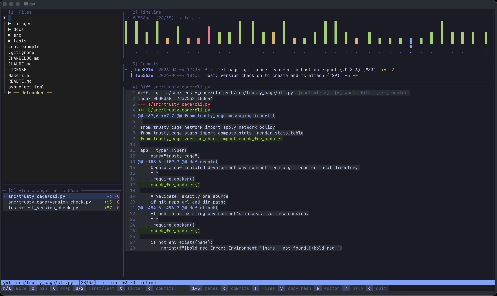
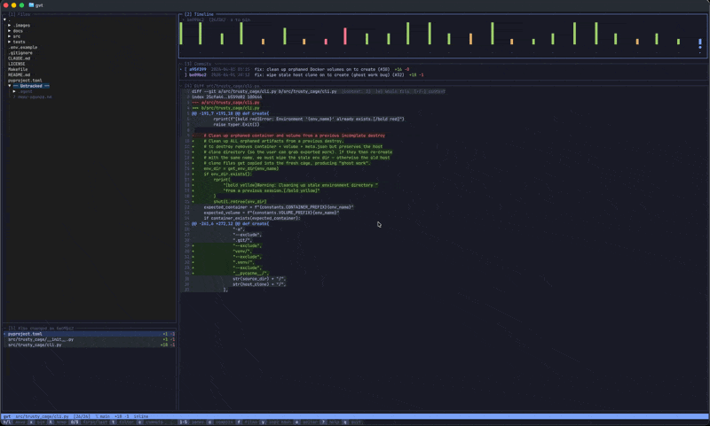
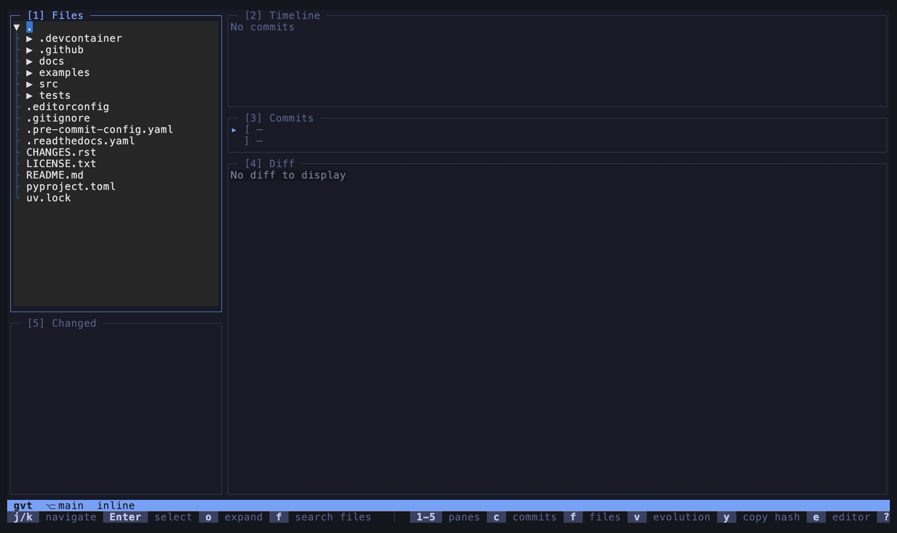

# gvt — Git Visual Timeline

A keyboard-driven TUI for exploring the commit history of any file in a git repo. Think lazygit meets a video timeline scrubber, focused on per-file history.



**gvt is a read-only history explorer, not a git UI.** It doesn't stage, commit, push, or manage branches — lazygit is great for that. gvt does one thing: lets you scrub through a file's commit timeline, see what changed and when, and understand how code evolved over time. It's the tool you reach for when you're staring at a file and asking "how did this get here?"

## Install

```bash
pipx install git-visual-timeline
```

[pipx](https://pipx.pypa.io/) installs `gvt` in an isolated environment and puts it on your PATH — the recommended way to install Python CLI tools. Install pipx itself with `brew install pipx` (macOS) or `apt install pipx` (Debian/Ubuntu).

## Usage

```bash
# Open in any git repo
gvt

# Jump directly to a file
gvt path/to/file.py

# Print the Evolution exclusion rules for the current repo
gvt --show-rules
```

Looking at someone else's project? Open gvt in a fresh `git clone` of it, not in a directory that came with its own `.git`. See [Untrusted repositories](#untrusted-repositories).

## Layout

gvt uses a 5-pane layout, each accessible by number key:

| Pane | Name | What it shows |
|------|------|---------------|
| 1 | Files | File tree with lazy-loading directories |
| 2 | Timeline | Heatmap of commits (green=adds, red=deletes, amber=mixed) |
| 3 | Commits | Message, hash, date, and stats for visible commits |
| 4 | Diff | Syntax-highlighted diff with blame, search, and context controls |
| 5 | Changed Files | All files touched by the current commit |

## Features

### Timeline Navigation

Scrub through a file's commit history one tick at a time. Each tick is colored by change type — green for additions, red for deletions, amber for mixed.



### Pin Mode

Press `x` to pin a commit, then move to another and press `x` again to diff any two commits. Press `x` a third time to clear. Use `X` to snap the nearest pin to your cursor.


### Inline Blame

Toggle blame annotations with `b` to see who last modified each line, right-aligned alongside the diff.


### File Search

Press `f` for an fzf-style fuzzy file picker that filters as you type.


### Commit Search

Press `c` to fuzzy search the 500 most recent non-merge commits reachable from HEAD by message, branch, or author.


### Evolution

Press `v` to see how code grew over time. It covers whatever is highlighted in the file tree (a file, a directory, or `.` for the whole repo), or the file open in the timeline.



- **Calendar** — a year of days shaded by commit count, like a GitHub contribution graph. `[` / `]` page back and forward a year.
- **Frequency** — lines added (up) and deleted (down) across the project's whole history, from the repo's first commit to today, in daily bars when they fit and weekly, monthly or yearly bars otherwise. Press `m` for **volume** mode: the code's size over time above churn bars (lines added + deleted), like price and volume on a stock chart. The status line shows how much of the code changed in that period.
- **Hotspots** — the files that change most often, ranked by commit count with recent commits counting more: a commit's weight halves every quarter of the history shown (at least every 30 days), so `t 3m` focuses on the last few months. Each row shows the commit count, lines added and deleted, and when the file last changed. Files that no longer exist are left out. Press `Enter` to open a file in the timeline.
- **Release tags** marked on both time axes.
- **Jump to history** — press `Enter` on a day or week to list its commits, then open one in the timeline.

`Tab` switches views, `u` widens the scope one folder at a time, and `Esc` goes back. An active time filter (`t`) carries over.

#### Authored vs everything

Lockfiles, generated snapshots, minified bundles and vendored code are committed on purpose but say little about how a project evolves. By default the Evolution views count only **authored** code:

- `x` switches between authored and everything.
- `X` opens the exclusion details: what was left out and by which rule, the largest files still counted (with a hint when a preset that's off would catch them), and how the rules were built. Press `x` inside it to switch modes without closing it.
- `gvt --show-rules` prints the rules for the current repo.

The defaults work without any setup. To change them, see [Configuring Evolution exclusions](#configuring-evolution-exclusions).

### All Features

- **Evolution** (`v`) — contribution calendar, code frequency and volume charts, and hotspots for a file, directory or the whole repo, counting only authored code by default
- **Syntax-highlighted diffs** with inline, whole-file (`w`), and side-by-side (`d`) views
- **Diff search** (`/`) — regex search within the diff with `n`/`p` to navigate matches
- **Commit search** (`c`) — fuzzy search the 500 most recent non-merge commits reachable from HEAD by message, branch, or author, then open a file at that commit
- **Time filter** (`t`) — filter timeline by date range (1w, 1m, 3m, 6m, 1y, custom date)
- **Contributor breakdown** (`B`) — who changed the file and how much
- **WIP indicator** — hollow tick showing uncommitted changes
- **Copy to clipboard** (`y`/`Y`) — short or full commit hash
- **Open in editor** (`e`) — open current file in `$VISUAL`/`$EDITOR`/vim (arguments like `code --wait` work)
- **Remember last file** — reopens to the last file you were viewing per repo
- **tmux integration** — `Ctrl+h/j/k/l` moves between gvt's panes and on into tmux panes at the edges (see [tmux pane navigation](#tmux-pane-navigation))
- **Preloaded diffs** — adjacent commits pre-cached for instant navigation
- **Context-sensitive status bar** showing relevant shortcuts per pane

## Keybindings

### Global

| Key | Action |
|-----|--------|
| `1`-`5` | Jump to pane |
| `Ctrl+h/j/k/l` | Navigate panes directionally |
| `c` | Search commits (all repo) |
| `f` / `Ctrl+P` | Search files |
| `t` | Time filter |
| `w` | Toggle whole-file view |
| `d` | Toggle side-by-side diff |
| `b` | Toggle inline blame |
| `B` | Contributor breakdown |
| `/` | Search in diff |
| `n`/`p` | Next/prev diff hunk |
| `y` / `Y` | Copy short/full commit hash |
| `e` | Open file in editor |
| `v` | Evolution (calendar, frequency, hotspots) |
| `?` | Help |
| `q` | Quit (with confirmation) |
| `qq` | Quit immediately |

### Timeline (Pane 2)

| Key | Action |
|-----|--------|
| `h`/`l` | Move cursor |
| `0`/`$` | Jump to first/last commit |
| `x` | Pin commit (1st=start, 2nd=end, 3rd=clear) |
| `X` | Snap nearest pin to cursor |

### Diff (Pane 4)

| Key | Action |
|-----|--------|
| `j`/`k` | Scroll vertically |
| `h`/`l` | Scroll horizontally |
| `g`/`G` | Top/bottom |
| `+`/`-` | More/less context lines |

### Evolution (`v`)

| Key | Action |
|-----|--------|
| `Tab` / `Shift+Tab` / `1`-`3` | Switch view |
| `h`/`l` | Move a week (calendar) or a period (frequency) |
| `j`/`k` | Move a day (calendar) or a file (hotspots) |
| `[` / `]` | Page back/forward a year (calendar) |
| `0`/`$` | First/last period (frequency) |
| `m` | Toggle volume mode (frequency) |
| `g`/`G`, `Home`/`End` | First/last file (hotspots) |
| `PgUp`/`PgDn` | Page through files (hotspots) |
| `u` | Widen to the parent folder: file → folder → … → whole repo (the title flashes) |
| `Ctrl+h/j/k/l` | Move to the neighboring tmux pane |
| `x` | Toggle authored only / everything |
| `X` | Exclusion details: what's left out and why |
| `Enter` | List commits, then open one in the timeline; in hotspots, open the file |
| `Esc` | Back |

### Search Modals

| Key | Action |
|-----|--------|
| `Tab` / `Shift+Tab` | Navigate results |
| `Ctrl+n` / `Ctrl+p` | Navigate results (alternative) |
| `Enter` | Select |
| `Esc` | Close |

### tmux pane navigation

gvt works with [vim-tmux-navigator](https://github.com/christoomey/vim-tmux-navigator)-style bindings: `Ctrl+h/j/k/l` moves between gvt's panes, and at an edge (or anywhere in the Evolution screen) it moves on to the neighboring tmux pane. Terminals send `Ctrl+h` as the same key code as Backspace, so Backspace moves left too. For tmux to pass these keys to gvt, its `is_vim` check has to recognize gvt. gvt runs under Python, so on macOS `ps -o comm=` shows `Python` rather than `gvt`; match the command line too:

```tmux
is_vim="ps -o state= -o comm= -t '#{pane_tty}' | grep -iqE '^[^TXZ ]+ +(\\S+\\/)?g?(view|l?n?vim?x?|fzf)(diff)?$' || ps -o state= -o args= -t '#{pane_tty}' | grep -iqE '^[^TXZ ]+ +\\S*[Pp]ython\\S* +(\\S+/)?gvt( |$)'"
```

## Configuring Evolution exclusions

The Evolution screen can leave out files that are committed but not written by hand, so its charts show how the code itself evolves. This section covers how those rules are decided and how to change them.

### Quick start

Most projects need nothing: lockfiles, minified bundles, generated snapshots and vendored code are excluded out of the box. To exclude more, add a `.gvt.toml` to the repo root:

```toml
[evolution]
exclude = ["packages/core/src/data/**", "*.generated.ts"]
```

Then run `gvt --show-rules` (or press `X` in the Evolution screen) to confirm what's excluded.

### Where rules come from

Rules are collected from these layers, in this order. When several rules match a path, **the last one wins**, and a rule starting with `!` brings a path back in:

1. **Built-in presets**: named groups of patterns (below). Four are on by default.
2. **`.gitattributes`**: paths marked `linguist-generated`, `linguist-vendored` or `linguist-documentation` are excluded. These are the markers GitHub uses to hide generated code from language stats, so many repos already have them. A path that unsets one (`-linguist-generated` or `linguist-generated=false`) is re-included.
3. **User config**: `~/.config/gvt/config.toml` applies to every repo you open. Set `$GVT_CONFIG` to use a different file.
4. **Repo config**: `.gvt.toml` at the repo root. Commit it so everyone on the team sees the same numbers.

Within the two config files, settings such as `default_mode` and `presets` are replaced by the later file (the repo wins). Lists of patterns (`exclude`, `ignore_files`) are added together, user first, then repo.

### Settings

Both config files use the same `[evolution]` table:

| Setting | Default | What it does |
|---|---|---|
| `default_mode` | `"authored"` | Mode the Evolution screen opens in: `"authored"` or `"everything"`. `x` switches at any time. |
| `presets` | `["lockfiles", "minified", "generated", "vendored"]` | Which built-in presets are on. Use `[]` to turn them all off. |
| `use_gitattributes` | `true` | Read linguist attributes from `.gitattributes`. |
| `exclude` | `[]` | Extra patterns (see syntax below). |
| `ignore_files` | `[]` | Files of patterns to read, one per line, e.g. `"tools/evolution-excludes.txt"` or `{ path = ".clocignore", syntax = "regex" }`. gvt reads only the files listed here. Paths are relative to the repo root; `~` works. Missing files are skipped quietly, so a user-level entry only applies to repos that have the file. |
| `trust_repo_regex` | `false` | Use regex rules that come from files inside a repo (its `.gvt.toml`, or an ignore file stored in the repo such as `.clocignore`). Only read from your own config; see [Untrusted repositories](#untrusted-repositories). |
| `ignore_revs` | `".git-blame-ignore-revs"` | File of commit SHAs to leave out entirely, such as repo-wide formatting passes. It's the same file `git blame` and GitHub use. Set to `""` to turn it off. |

### Presets

| Preset | On by default | Patterns |
|---|---|---|
| `lockfiles` | yes | `pnpm-lock.yaml`, `package-lock.json`, `npm-shrinkwrap.json`, `yarn.lock`, `bun.lock`, `bun.lockb`, `uv.lock`, `poetry.lock`, `pdm.lock`, `Pipfile.lock`, `Cargo.lock`, `Gemfile.lock`, `composer.lock`, `mix.lock`, `flake.lock`, `go.sum` |
| `minified` | yes | `*.min.js`, `*.min.css`, `*.map` |
| `generated` | yes | `*.snap`, `*.tsbuildinfo`, `**/migrations/meta/*_snapshot.json`, `**/alembic/versions/` |
| `vendored` | yes | `vendor/`, `third_party/` |
| `docs` | no | `docs/`, `*.md`, `*.rst` |
| `data` | no | `*.json`, `*.csv`, `*.svg` |

### Pattern syntax

Patterns work like `.gitignore` and match paths relative to the repo root:

| Pattern | Matches |
|---|---|
| `yarn.lock` | A file or directory with that name at any depth |
| `vendor/` | Everything under any directory named `vendor` |
| `/docs` or `src/*.py` | Anchored at the repo root, because it contains a `/` |
| `*` / `**` | Any characters within one path segment / across segments |
| `?`, `[abc]`, `[!abc]` | One character, a set, a negated set |
| `!docs/keep.md` | Re-include a path an earlier rule excluded |
| `re:^src/legacy/` | A regular expression, searched anywhere in the path (from a repo file, only with `trust_repo_regex`) |

Lines in `ignore_files` use the same syntax unless the entry says `syntax = "regex"`, in which case every line is a regular expression. Blank lines and lines starting with `#` are ignored.

Globs are matched without regular expressions, so no single pattern can make matching blow up. Regular expressions use Python's `re` module, so they're only accepted from sources you trust (next section).

### Untrusted repositories

When inspecting someone else's project, use a fresh Git clone. gvt runs Git in the local checkout and trusts its Git metadata and local configuration. For a directory supplied with an existing `.git`, follow [Git’s security guidance](https://git-scm.com/docs/git#_security).

Exclusion rules can come from files inside the repo you're viewing: `.gvt.toml`, `.gitattributes`, and ignore files stored in the repo. When the repo came from someone else, gvt treats those files as untrusted:

- **Regex rules from repo files are skipped** unless your own config sets `trust_repo_regex = true`. A crafted regex can take hours to match, and a repo can't grant itself trust. Skipped rules are listed as warnings in `X` and `gvt --show-rules`.
- **`.gitattributes` patterns are always globs**, as in git.
- **Paths in a repo's `.gvt.toml`** (`ignore_files`, `ignore_revs`) must stay inside the repo. Absolute paths, `~`, `..` and symlinks that lead outside are refused.
- **Limits:** files over 256 KB are skipped; each config or rule file contributes at most 1,000 rules; patterns over 256 characters or 16 path segments are skipped; and paths longer than 1,024 characters or nested more than 64 folders deep are never excluded.
- **Totals across all sources:** at most 100 `ignore_files` entries (repeats and missing files count), 2 MB read from config and rule files, and 5,000 rules. Past any of these, gvt loads no exclusion rules, shows all history, and says so in a warning in `v` and `gvt --show-rules`.
- **A time budget:** if applying the rules to a scope takes more than 5 seconds, gvt shows everything for that scope and says so, instead of keeping you waiting. Leaving the Evolution screen (or widening it) also stops the work.
- **Malformed config** (wrong types, deeply nested TOML) becomes a warning, never a crash. gvt keeps the first 50 warnings, each up to 300 characters, and counts the rest; `v` shows the first 3 as pop-ups and `X` lists them all.

`trust_repo_regex` applies to every repo you open. Turn it on only if you mostly view your own repos, or keep your ignore files to globs.

### What exclusions change

- **Changed:** the calendar, frequency and volume charts and the summary line count only lines in files that aren't excluded, and hotspots leave excluded files out.
- **Dropped commits:** commits that touch only excluded files (a lockfile bump, a snapshot update) disappear from commit counts, the calendar and the commit list. The same goes for commits listed in `ignore_revs`.
- **Not changed:** the main timeline, diffs, blame, commit search (`c`) and the file picker always show everything.

### Checking your rules

- **`X` in the Evolution screen** shows how many lines were excluded and what share of all changes that is, which files each rule caught, the largest files still counted, and each layer with whether it was found.
- **`gvt --show-rules`** prints the merged rules and the config files it found, from the shell.
- **Problems** in a config file appear as a warning when the Evolution screen opens and in both of the above. An unknown preset or an invalid regular expression is skipped on its own; a file that isn't valid TOML is skipped entirely. Everything else still applies.

### Examples

**Count docs and data too**, and keep one doc. Since `presets` replaces the defaults, list every preset you want:

```toml
[evolution]
presets = ["lockfiles", "minified", "generated", "vendored", "docs", "data"]
exclude = ["!docs/architecture.md"]
```

**Leave out a monorepo's database migrations and seed data:**

```toml
[evolution]
exclude = ["migrations/", "packages/db/seed/**", "re:^apps/[^/]+/public/"]
```

**Reuse an existing ignore list**, here one of regular expressions kept in each repo. Regex rules from files inside a repo need `trust_repo_regex`, which only your own config can set:

```toml
# ~/.config/gvt/config.toml
[evolution]
trust_repo_regex = true
ignore_files = [{ path = ".clocignore", syntax = "regex" }]
```

**Count everything by default**, but keep the rules one keypress away:

```toml
[evolution]
default_mode = "everything"
```

### Why the numbers differ from cloc

gvt counts every line added or removed in git history, including comments and blank lines, so a repo's authored size in gvt is usually higher than cloc's code-line count, even with the same files excluded.

## Requirements

- Python 3.10+
- A git repository

## License

MIT
