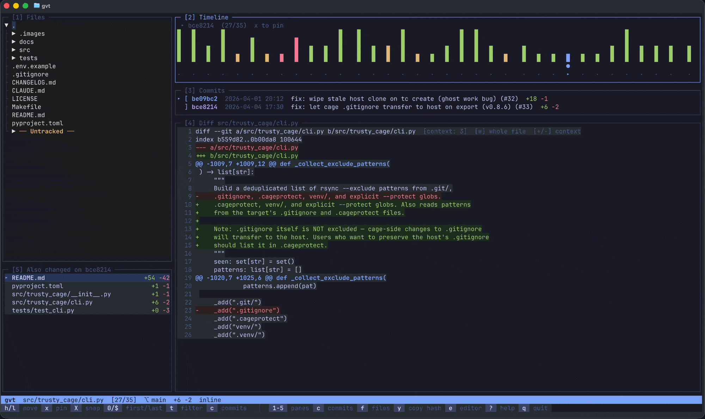
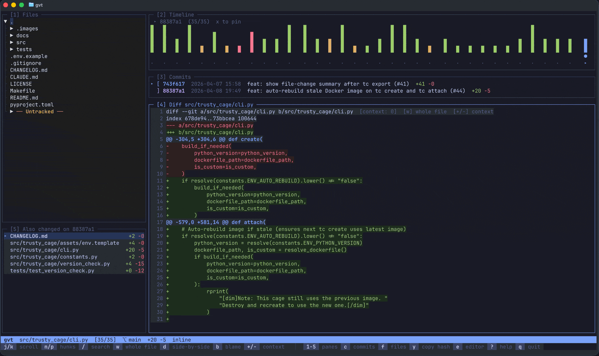
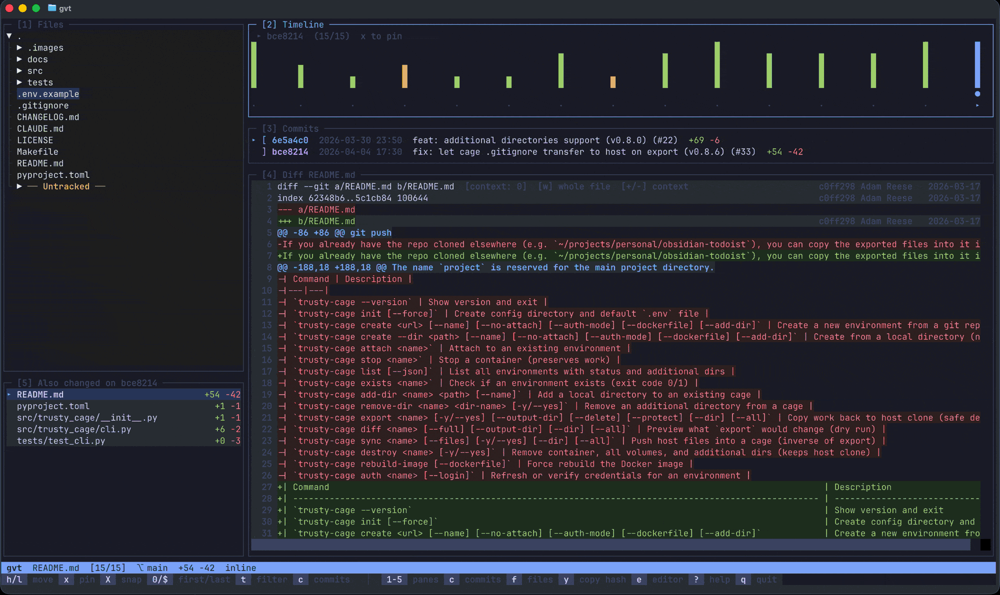
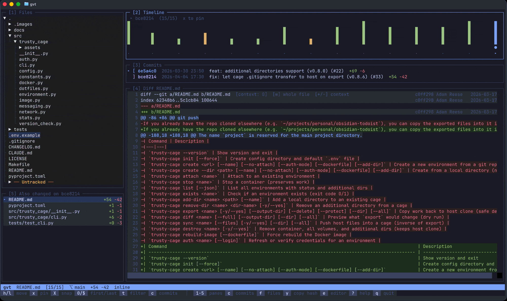

# gvt — Git Visual Timeline

A keyboard-driven TUI for exploring the commit history of any file in a git repo. Think lazygit meets a video timeline scrubber, focused on per-file history.


**gvt is a read-only history explorer, not a git UI.** It doesn't stage, commit, push, or manage branches — lazygit is great for that. gvt does one thing: lets you scrub through a file's commit timeline, see what changed and when, and understand how code evolved over time. It's the tool you reach for when you're staring at a file and asking "how did this get here?"

## Install

```bash
pipx install git-visual-timeline
```

[pipx](https://pipx.pypa.io/) installs `gvt` in an isolated environment and puts it on your PATH — the recommended way to install Python CLI tools. Install pipx itself with `brew install pipx` (macOS) or `apt install pipx` (Debian/Ubuntu).

## Usage

```bash
# Open in any git repo
gvt

# Jump directly to a file
gvt path/to/file.py
```

## Layout

gvt uses a 5-pane layout, each accessible by number key:

| Pane | Name | What it shows |
|------|------|---------------|
| 1 | Files | File tree with lazy-loading directories |
| 2 | Timeline | Heatmap of commits (green=adds, red=deletes, amber=mixed) |
| 3 | Commits | Message, hash, date, and stats for visible commits |
| 4 | Diff | Syntax-highlighted diff with blame, search, and context controls |
| 5 | Changed Files | All files touched by the current commit |

## Features

### Timeline Navigation

Scrub through a file's commit history one tick at a time. Each tick is colored by change type — green for additions, red for deletions, amber for mixed.


### Pin Mode

Press `x` to pin a commit, then move to another and press `x` again to diff any two commits. Press `x` a third time to clear. Use `X` to snap the nearest pin to your cursor.



### Inline Blame

Toggle blame annotations with `b` to see who last modified each line, right-aligned alongside the diff.



### File Search

Press `f` for an fzf-style fuzzy file picker that filters as you type.



### Commit Search

Press `c` to fuzzy search all repo commits by message, branch, or author.



### Evolution

Press `v` to see how code grew over time. It covers whatever is highlighted in the file tree (a file, a directory, or `.` for the whole repo), or the file open in the timeline.

- **Calendar** — a year of days shaded by commit count, like a GitHub contribution graph. `[` / `]` page back and forward a year.
- **Frequency** — lines added (up) and deleted (down) per week, switching to months or years for long histories. Press `m` for **volume** mode: the code's size over time above churn bars (lines added + deleted), like price and volume on a stock chart. The status line shows how much of the code changed in that period.
- **Release tags** marked on both time axes.
- **Jump to history** — press `Enter` on a day or week to list its commits, then open one in the timeline.

`Tab` switches views and `Esc` goes back. An active time filter (`t`) carries over.

#### Authored vs everything

Lockfiles, generated snapshots, minified bundles and vendored code are committed on purpose but say little about how a project evolves. By default the Evolution views count only **authored** code; press `x` to include everything, or `X` to see which rules removed what. `gvt --show-rules` prints the rules for the current repo.

Rules come from these layers, in order. The last matching rule wins, and a leading `!` brings a path back:

1. **Built-in presets.** On by default: `lockfiles`, `minified`, `generated` (snapshots, `*.tsbuildinfo`, migration snapshots) and `vendored`. Also available: `docs` (`docs/`, `*.md`, `*.rst`) and `data` (`*.json`, `*.csv`, `*.svg`).
2. **`.gitattributes`** files marked `linguist-generated`, `linguist-vendored` or `linguist-documentation`, the same markers GitHub uses.
3. **Your config** at `~/.config/gvt/config.toml` (or the path in `$GVT_CONFIG`).
4. **The repo's `.gvt.toml`**, which you can commit to share with your team.

```toml
[evolution]
default_mode = "authored"        # or "everything"
presets = ["lockfiles", "minified", "generated", "vendored", "docs"]
use_gitattributes = true
exclude = [
  "packages/core/src/data/**",    # gitignore-style globs
  "re:^docs/prototype/",          # re: for a regular expression
  "!docs/architecture.md",        # ! re-includes
]
ignore_files = [{ path = ".clocignore", syntax = "regex" }]  # reuse an existing list
ignore_revs = ".git-blame-ignore-revs"                       # drop formatting-only commits
```

Commits that touch only excluded files (like a lockfile bump) don't count in authored mode. Commits listed in `.git-blame-ignore-revs` are left out by default.

### All Features

- **Syntax-highlighted diffs** with inline, whole-file (`w`), and side-by-side (`d`) views
- **Diff search** (`/`) — regex search within the diff with `n`/`p` to navigate matches
- **Commit search** (`c`) — fuzzy search all repo commits by message, branch, or author
- **Time filter** (`t`) — filter timeline by date range (1w, 1m, 3m, 6m, 1y, custom date)
- **Contributor breakdown** (`B`) — who changed the file and how much
- **WIP indicator** — hollow tick showing uncommitted changes
- **Copy to clipboard** (`y`/`Y`) — short or full commit hash
- **Open in editor** (`e`) — open current file in `$VISUAL`/`$EDITOR`/vim
- **Remember last file** — reopens to the last file you were viewing per repo
- **tmux integration** — seamless pane switching at edges
- **Preloaded diffs** — adjacent commits pre-cached for instant navigation
- **Context-sensitive status bar** showing relevant shortcuts per pane

## Keybindings

### Global

| Key | Action |
|-----|--------|
| `1`-`5` | Jump to pane |
| `Ctrl+h/j/k/l` | Navigate panes directionally |
| `c` | Search commits (all repo) |
| `f` / `Ctrl+P` | Search files |
| `t` | Time filter |
| `w` | Toggle whole-file view |
| `d` | Toggle side-by-side diff |
| `b` | Toggle inline blame |
| `B` | Contributor breakdown |
| `/` | Search in diff |
| `n`/`p` | Next/prev diff hunk |
| `y` / `Y` | Copy short/full commit hash |
| `e` | Open file in editor |
| `v` | Evolution (calendar, frequency) |
| `?` | Help |
| `q` | Quit (with confirmation) |
| `qq` | Quit immediately |

### Timeline (Pane 2)

| Key | Action |
|-----|--------|
| `h`/`l` | Move cursor |
| `0`/`$` | Jump to first/last commit |
| `x` | Pin commit (1st=start, 2nd=end, 3rd=clear) |
| `X` | Snap nearest pin to cursor |

### Diff (Pane 4)

| Key | Action |
|-----|--------|
| `j`/`k` | Scroll vertically |
| `h`/`l` | Scroll horizontally |
| `g`/`G` | Top/bottom |
| `+`/`-` | More/less context lines |

### Evolution (`v`)

| Key | Action |
|-----|--------|
| `Tab` / `Shift+Tab` / `1`-`2` | Switch view |
| `h`/`l` | Move a week (calendar) or a period (frequency) |
| `j`/`k` | Move a day (calendar) |
| `[` / `]` | Page back/forward a year (calendar) |
| `0`/`$` | First/last period (frequency) |
| `m` | Toggle volume mode (frequency) |
| `x` | Toggle authored only / everything |
| `X` | Show exclusion rules |
| `Enter` | List commits, then open one in the timeline |
| `Esc` | Back |

### Search Modals

| Key | Action |
|-----|--------|
| `Tab` / `Shift+Tab` | Navigate results |
| `Ctrl+n` / `Ctrl+p` | Navigate results (alternative) |
| `Enter` | Select |
| `Esc` | Close |

## Requirements

- Python 3.10+
- A git repository

## License

MIT
